# Star Tracker Report

**2026-10-21** | Total: **0 stars** | Change: **0**

> Compared to snapshot from 2026-10-20

## 📈 Star Trend

### By Repository

Individual Repository Charts

#### jifa3650-sketch/vpn-configs-for-russia

## Repositories

| Repositories | Stars | Change | Trend |
|:-----------|------:|-------:|:-----:|
| [jifa3650-sketch/vpn-configs-for-russia](https://github.com/jifa3650-sketch/vpn-configs-for-russia) | 0 | 0 | ➖ |

## 🔮 Growth Forecast

**Aggregate Forecast**

| Method | Week 1 | Week 2 | Week 3 | Week 4 |
|:---|---:|---:|---:|---:|
| Linear Regression | 0 | 0 | 0 | 0 |
| Weighted Moving Average | 0 | 0 | 0 | 0 |

### By Repository

jifa3650-sketch/vpn-configs-for-russia

**jifa3650-sketch/vpn-configs-for-russia**

| Method | Week 1 | Week 2 | Week 3 | Week 4 |
|:---|---:|---:|---:|---:|
| Linear Regression | 0 | 0 | 0 | 0 |
| Weighted Moving Average | 0 | 0 | 0 | 0 |

---
*Generated by [GitHub Star Tracker](https://github.com/fbuireu/github-star-tracker) on 2026-10-21T04:47:42.999Z*

*Made with 🤘 by [Ferran Buireu](https://github.com/fbuireu)*

